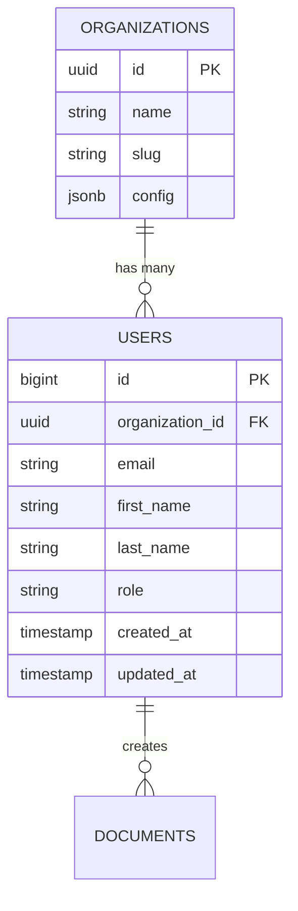

# Database Diagram Generator

Reads the database schema and generates an ER diagram in Mermaid.

## Process

### 1. Detect the schema source

Search in order of priority:

| Source | Typical location |
|--------|-----------------|
| Migrations SQL | `db/migrations/`, `migrations/`, `prisma/migrations/` |
| ORM Models | `models/`, `src/core/entities/`, `app/models/` |
| Prisma Schema | `prisma/schema.prisma` |
| SQLAlchemy | `models.py`, `models/` |
| GORM structs | `*.go` with `gorm:"..."` tags |
| Django Models | `models.py` in each app |
| TypeORM | `*.entity.ts` |
| Drizzle | `schema.ts`, `schema/` |

### 2. Parse tables and relationships

For each table/model extract:
- Table name
- Columns: name, type, nullable, default
- Primary key
- Foreign keys → referenced table
- Unique indexes
- Relationships: 1:1, 1:N, N:M

### 3. Generate the Mermaid ER



### 4. Output

1. Show the Mermaid diagram on screen
2. If the user wants to save it → write it to `docs/db-diagram.md` or `docs/schema.md`
3. Include a summary table:

```markdown
## Tables
| Table | Columns | FK | Description |
|-------|----------|-----|-------------|

## Relationships
| Table A | → | Table B | Type | Via |
|---------|---|---------|------|----|
```

## Rules
- If there are multiple sources (migrations + models), prefer migrations as the source of truth
- Group related tables visually
- Mark nullable fields with `?`
- Descriptions in the user's language, table names as they appear in the code
- If the schema is very large (>20 tables), offer to generate it per module/domain
